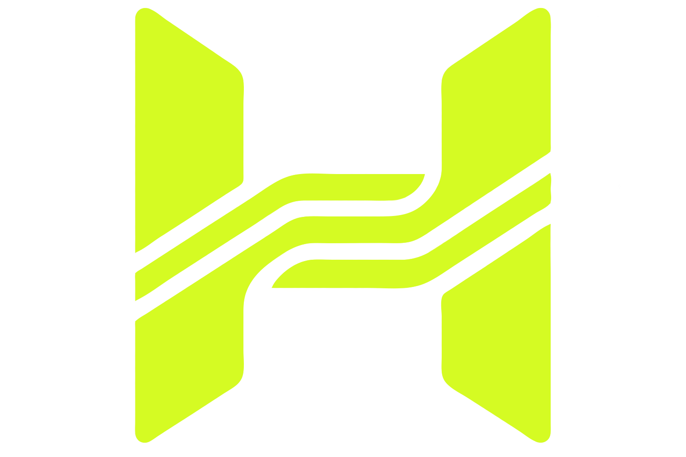

# MrCrypPrivacy

**Open-Source Maintainer & Contributor · Privacy · Security · Software**

### ɴᴏ ᴅᴀᴛᴀ. ɴᴏ ᴛʀᴜꜱᴛ. ᴋɴᴏᴡ ᴇᴠᴇʀʏ ᴠᴜʟɴ.

---

## About

I build open-source software that turns real-world problems into practical tools, prioritizing transparency, local processing, and minimal reliance on third-party services.

## What I Work On

**🧑‍💻 Open Source** · **🛡️ Privacy** · **🔐 Security** · **⚙️ Software**

Security research & tooling · Privacy-focused applications · Local-first software · Blockchain & decentralized technologies

## Open Source

I believe software should be **transparent, auditable, and accessible**, empowering people to understand their tools and retain control over their technology and data.

